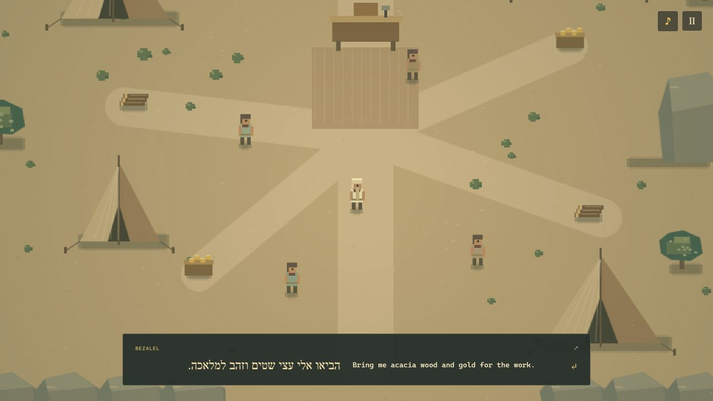
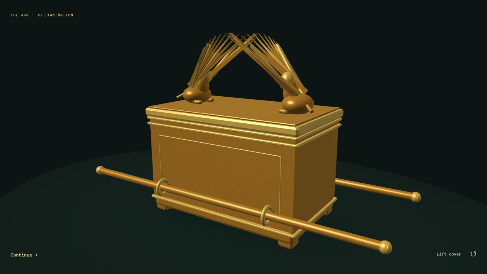

# The Arkkeepers

**Build the Ark. Cross the Jordan. Make it to Jerusalem.**

Start in a desert camp with a pile of wood and gold. Before long, you’re carrying the Ark across a river and marching around the walls of Jericho. Want a quick challenge? Jump into **Trials** and see if you can get the Ark past a rival company.

**[Play The Arkkeepers](https://zeidal-ruzouq.github.io/arkkeepers/)**

- **Story** — Play through six chapters with Hebrew and English dialogue side by side.
- **Trials** — Pick a keeper, read the rival’s next move, and decide when to brace or push ahead.
- **3D Ark** — Open it from Pause or at a story checkpoint. Spin it around and lift the lid to see inside.

Click or tap to move and interact. You can also use **WASD** or **arrow keys** to move, **E** to interact, and **Esc** to pause.

## Where things are

| Path | What’s inside |
| --- | --- |
| [docs/index.html](docs/index.html) | The game screen, menus, and dialogue boxes. |
| [docs/game/](docs/game/) | `game.js` connects the controls and screen. `engine.js` handles movement and chapters. The other files handle dialogue, trials, pixel art, and sound. |
| [docs/ark/](docs/ark/) | The 3D model and viewer code. The downloadable model is [ark.glb](docs/assets/ark.glb). |
| [docs/styles/](docs/styles/) | Styles for the game, menus, and touch controls. |
| [docs/research/](docs/research/) | The story sources and notes behind the game and the model. |
| [scripts/](scripts/) and [tests/](tests/) | Local preview, asset builders, and checks for the journey, movement, dialogue, trials, and model. |

Run `node scripts/serve.mjs` and open [localhost:4173](http://127.0.0.1:4173) to play locally. Run `node --test` to check the game. No packages to install.

## Screenshots

Class project by Zeid Al Ruzouq, Jackson Hanselman, and Thomas Lapp. [Read the research notes](docs/research/RESEARCH.md).
